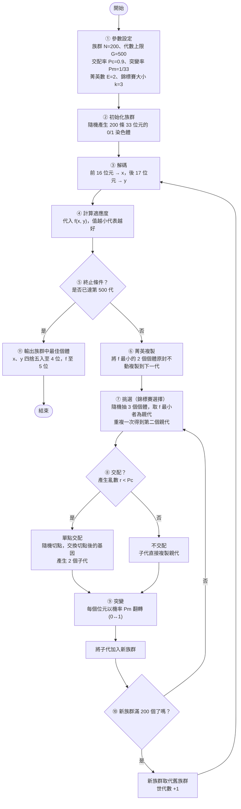

# GA 演算法設計說明

**問題**：求下式在 x ∈ [-1.5, 4]、y ∈ [-3, 4] 的最小值

$$f(x, y) = (x - y)^2 - x + 2y + \sin(x + y) + 1$$

精度要求：x、y 精確到小數點後第 4 位，f 精確到小數點後第 5 位。
對應程式：[ga_min.py](ga_min.py)

---

## 1. 基因演算法流程圖



| 步驟 | 說明 |
|---|---|
| ① 參數設定 | 決定族群大小、代數、交配率、突變率等（理由見第 3、6、7 節） |
| ② 初始化 | 每個位元以 50% 機率為 0 或 1，讓初始解均勻散佈在整個搜尋區域 |
| ③ 解碼 | 二進位 → 整數 → 線性映射到實數區間（見第 2 節） |
| ④ 評估 | 計算每個個體的適應度（見第 4 節） |
| ⑤ 終止判斷 | 達代數上限即停止（見第 7 節） |
| ⑥ 菁英複製 | 保證目前最佳解不會因交配、突變而遺失 |
| ⑦ 挑選 | 錦標賽選擇，好的個體較容易成為親代 |
| ⑧ 交配 | 以 Pc 機率進行單點交配，組合親代優點 |
| ⑨ 突變 | 以 Pm 機率逐位元翻轉，維持多樣性 |
| ⑩ 族群更新 | 新族群填滿後取代舊族群，進入下一代 |
| ⑪ 輸出 | 回傳最佳個體並依題目要求的位數四捨五入 |

---

## 2. 二進位編碼設計

### 2.1 編碼方式

一條染色體 = **x 的基因段 (16 位元)** 接上 **y 的基因段 (17 位元)**，共 **33 位元**：

```
| b1 b2 ... b16 | b17 b18 ... b33 |
|  x 段 (16)    |   y 段 (17)     |
```

### 2.2 位元數計算

精度 1e-4 代表區間要切成「範圍長度 ÷ 0.0001」等分，需要的離散點數 = 等分數 + 1，
位元數 m 須滿足 **2^m ≥ 點數**（亦即 2^m − 1 ≥ 等分數）。

**x：** 範圍 [-1.5, 4]，長度 = 4 − (−1.5) = 5.5

- 等分數 = 5.5 / 0.0001 = 55,000
- 2^15 = 32,768 < 55,001，不足
- 2^16 = 65,536 ≥ 55,001，足夠 → **x 需 16 位元**

**y：** 範圍 [-3, 4]，長度 = 4 − (−3) = 7

- 等分數 = 7 / 0.0001 = 70,000
- 2^16 = 65,536 < 70,001，不足
- 2^17 = 131,072 ≥ 70,001，足夠 → **y 需 17 位元**

一般式：m = ⌈log₂((b − a) / 精度 + 1)⌉
- x：⌈log₂(55,001)⌉ = ⌈15.75⌉ = 16
- y：⌈log₂(70,001)⌉ = ⌈16.10⌉ = 17

### 2.3 解碼公式

先把二進位字串轉成十進位整數 d，再線性映射到區間 [a, b]：

$$x = a + d \times \frac{b - a}{2^m - 1}$$

- x 的實際解析度 = 5.5 / (2^16 − 1) = 5.5 / 65,535 ≈ **0.0000839** < 0.0001 ✔
- y 的實際解析度 = 7 / (2^17 − 1) = 7 / 131,071 ≈ **0.0000534** < 0.0001 ✔

**範例：** x 段全為 0 → d = 0 → x = −1.5；全為 1 → d = 65,535 → x = 4.0，兩端點都能表示。

---

## 3. 族群規模決策

**採用 N = 200。** 依據如下：

1. **搜尋空間大小**：33 位元共 2^33 ≈ 86 億種組合，族群太小只能看到極少部分的空間，容易收斂到錯誤區域。
2. **染色體長度經驗法則**：常見建議族群大小約為染色體長度的 2～10 倍（33 × 2 ≈ 66 到 33 × 10 = 330），200 落在此範圍中段。
3. **精度要求高**：題目要求 f 精確到小數第 5 位，最後幾個低位元必須被正確搜尋到，族群需要足夠的多樣性讓這些位元有機會組合出正確值。
4. **計算成本可接受**：每代 200 次函數計算，500 代共 10 萬次，Python 執行只需數秒。

**實驗驗證**（Pc = 0.9、Pm = 1/33、500 代，以 30 組不同亂數種子測試，計算求得正確答案 f = −1.47572 的次數）：

| 族群大小 N | 10 | 20 | 50 | 100 | **200** |
|---|---|---|---|---|---|
| 成功次數 / 30 | 6 | 9 | 17 | 29 | **30** |

N = 100 已接近穩定，N = 200 達到 30/30，因此選 200 作為「穩定且成本低」的折衷。

---

## 4. 適應函數設計

**定義：適應度 = f(x, y)，且「值越小越好」。**

```python
def fitness(chrom):
    return f(*decode(chrom))  # 求最小值：值越小越好
```

**設計理由：**

1. **直接對應目標**：題目是求最小值，以 f 本身評估最直觀，不需額外轉換，也不會因轉換引入誤差。
2. **搭配錦標賽選擇，不需轉成正數**：輪盤選擇法要求適應度為正，且「越大越好」，若使用輪盤法就必須轉換成例如 `F = C − f` 或 `F = 1 / (1 + f − f_min)`；
   但本設計使用錦標賽選擇，只比較個體間的**大小順序**（取 f 最小者），因此 f 為負數也沒有問題。
3. **不受函數尺度影響**：錦標賽只看排名，不會因為某個體 f 值特別突出就壟斷整個族群（輪盤法的「超級個體」問題），能避免過早收斂。
4. **無需懲罰項**：解碼公式保證 x、y 必定落在題目範圍內，所有個體皆為可行解，不需要額外處理邊界違規。

---

## 5. 挑選、複製、交配、突變機制

### 5.1 挑選（Selection）— 錦標賽選擇，k = 3

1. 從族群中**隨機抽出 3 個**個體
2. 比較其適應度，**f 最小者勝出**成為親代
3. 重複上述步驟取得第二個親代

- **為何選錦標賽**：只需比較大小，可直接處理負值與最小化問題；選擇壓力可用 k 調整。
- **為何 k = 3**：k = 2 選擇壓力偏弱，收斂慢；k 太大（如 10）則好個體被反覆選中，多樣性迅速流失。k = 3 為常用的中等壓力設定。

### 5.2 複製（Reproduction）— 菁英保留，E = 2

- 每代先將 **f 最小的 2 個個體原封不動複製**到下一代，剩下的 198 個名額由挑選→交配→突變產生。
- **理由**：交配與突變可能破壞好的染色體，菁英保留確保「最佳解只會越來越好、不會退步」。只保留 2 個（1%）是為了避免菁英占比太高而降低多樣性。
- 另外，當未發生交配時（機率 1 − Pc），子代直接複製親代，這也是一種複製。

### 5.3 交配（Crossover）— 單點交配，Pc = 0.9

1. 產生亂數 r，若 r < 0.9 則交配，否則子代直接複製親代
2. 在 1～32 之間隨機選一個切點
3. 交換兩親代切點之後的基因

```
親代1：1011 0|110 1...      子代1：1011 0|001 0...
親代2：0100 1|001 0...  →   子代2：0100 1|110 1...
               ↑ 切點
```

- **理由**：x、y 是串接的兩段，切點若落在 x、y 交界附近，等於把親代 1 的 x 與親代 2 的 y 組合，能有效混合兩個變數的好基因；實作簡單且是二進位 GA 的標準作法。

### 5.4 突變（Mutation）— 位元翻轉，Pm = 1/33

- 對子代的**每一個位元**，以機率 Pm 將 0 變 1、1 變 0。

```
突變前：1 0 1 1 0 1 0 ...
                ↓ (此位元被抽中)
突變後：1 0 1 1 1 1 0 ...
```

- **理由**：交配只能重組現有基因，若族群中所有個體某一位元都相同，只有突變能將其改變；突變也讓演算法能跳出區域最佳解。翻轉高位元會造成大幅跳躍（探索），翻轉低位元則是微調（精細化）。

---

## 6. 交配機率與突變機率的決定依據

### 6.1 交配機率 Pc = 0.9

- **文獻常用範圍 0.6～0.95**：交配是 GA 產生新解的主要動力，機率太低會使演化停滯，大部分子代只是親代的複製品。
- 本設計已有**菁英保留**保護最佳解，因此可以放心使用較高的交配率加速探索，不必擔心好解被破壞。
- 實驗（N = 50 這種較嚴苛的小族群，30 次）：Pc = 0.6 → 21 次、0.8 → 21 次、0.9 → 17 次成功，三者差異不大，表示 Pc 對結果不敏感；在 N = 200 時 Pc = 0.9 為 30/30。

### 6.2 突變機率 Pm = 1/L = 1/33 ≈ 0.0303

- **經驗法則 Pm = 1/L（L 為染色體長度）**：平均每條染色體恰好突變 **1 個位元**，既能持續引入新基因，又不會把好的染色體破壞殆盡。
- **太小**（如 0.001，平均每 30 條才突變 1 位元）：多樣性很快消失，族群卡在錯誤位置。實驗 N = 50 時僅 5/30 成功。
- **太大**（如 0.5）：GA 退化成隨機搜尋，前面的挑選與交配失去意義。
- 實驗（N = 50）：Pm = 0.001 → 5 次、1/33 → 17 次、0.1 → 30 次。小族群時提高突變率可彌補多樣性不足；而本設計採用 N = 200，在 Pm = 1/33 時已達 30/30，因此保留理論依據最明確的 1/L。

---

## 7. 終止條件設定與理由

**終止條件：演化達 500 代即停止**，輸出族群中最佳個體。

**理由：**

1. **保證結束**：固定代數上限讓程式執行時間可預測（約 10 萬次函數計算）。
2. **收斂速度實測**：執行結果顯示第 50 代時最佳解已到達 x = −0.6722、y = −1.4222、f = −1.47572，之後 450 代維持不變。
3. **安全邊際**：以 N = 200 測試 30 組種子：50 代 → 29/30、100 代 → 30/30、200 代 → 30/30。最慢的情況約需 100 代，設定 500 代保留約 5 倍的餘裕，以應付較差的亂數種子。
4. **搭配菁英保留**：因為最佳解不會退化，多跑幾代不會讓結果變差，只會增加些許計算時間。

> 可延伸的改良：加入「**連續 100 代最佳 f（取到小數第 5 位）沒有改善即提早停止**」的停滯條件，與 500 代上限並用，可省下收斂後多餘的計算。

---

## 8. 執行結果與驗證

```
x = -0.6722
y = -1.4222
f(x, y) 最小值 = -1.47572
```

**解析驗證**：令偏微分為 0

- ∂f/∂x = 2(x − y) − 1 + cos(x + y) = 0
- ∂f/∂y = −2(x − y) + 2 + cos(x + y) = 0

兩式相加：1 + 2cos(x + y) = 0 → cos(x + y) = −1/2；兩式相減：4(x − y) − 3 = 0 → x − y = 0.75

比較區間內各候選點（x + y = −2π/3、2π/3、4π/3 …）並檢查邊界，以 x + y = −2π/3 ≈ −2.0944 為最小（以 0.0025 間距的網格搜尋亦得相同結果），得
x = (−2.0944 + 0.75) / 2 ≈ **−0.6722**，y ≈ **−1.4222**，
f = 0.75² − x + 2y + sin(−2π/3) + 1 ≈ **−1.47572**，與 GA 結果一致。
